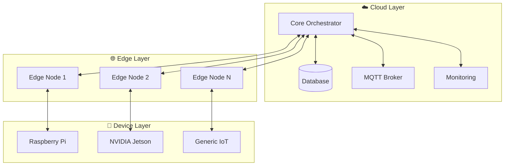
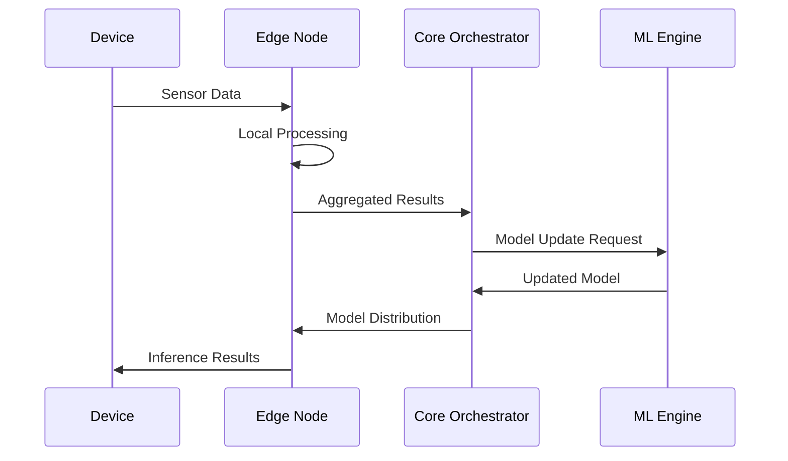

# 🧠 Neural Nexus - Arquitectura del Sistema

## 🎯 Visión General

Neural Nexus es una plataforma de IA distribuida diseñada para edge computing que combina:
- **Inferencia Descentralizada**: Procesamiento distribuido en nodos edge
- **Eficiencia Energética**: Optimización para dispositivos de baja potencia
- **Aprendizaje Federado**: Entrenamiento distribuido preservando privacidad
- **Procesamiento Neuromorphic**: Inspirado en el cerebro humano

## 🏗️ Arquitectura de Alto Nivel



## 🔧 Componentes Principales

### 1. 🎭 Core Orchestrator
- **Lenguaje**: Rust (performance crítico)
- **Función**: Coordinación de nodos, balanceo de carga
- **Protocolos**: gRPC, HTTP/2, WebSockets
- **Base de Datos**: PostgreSQL + Redis

### 2. 🧠 Inference Engine
- **Modelos**: ONNX, TensorRT, TensorFlow Lite
- **Optimización**: Quantización, pruning, distillation
- **Hardware**: CPU, GPU, TPU, neuromorphic chips

### 3. 🌐 Distributed Communication
- **Inter-nodos**: gRPC con load balancing
- **IoT Devices**: MQTT con QoS garantizado
- **Streaming**: Apache Kafka para datos en tiempo real

### 4. 🧬 Neuromorphic Processing
- **Inspiración**: Redes neuronales spiking
- **Procesamiento**: Eventos asíncronos
- **Eficiencia**: Ultra-baja latencia y consumo

## 📊 Flujo de Datos



## 🔄 Ciclo de Vida del Modelo

### 1. 📥 Ingesta de Datos
```rust
// Ejemplo de ingesta de datos
pub struct DataIngestion {
    pub sensor_id: String,
    pub timestamp: SystemTime,
    pub data: Vec<f32>,
    pub metadata: HashMap<String, String>,
}
```

### 2. 🎯 Procesamiento Local
```python
# Inferencia local en edge
class EdgeInference:
    def __init__(self, model_path: str):
        self.session = onnxruntime.InferenceSession(model_path)
    
    def predict(self, data: np.ndarray) -> np.ndarray:
        return self.session.run(None, {"input": data})[0]
```

### 3. 🌐 Agregación Distribuida
```rust
// Agregación de resultados
pub async fn aggregate_results(
    results: Vec<InferenceResult>
) -> AggregatedResult {
    // Federated averaging
    let weights = calculate_federated_weights(&results);
    apply_differential_privacy(weights)
}
```

## 🚀 Patrones de Despliegue

### 1. 🏭 Cluster Edge
```yaml
# Kubernetes deployment
apiVersion: apps/v1
kind: Deployment
metadata:
  name: neural-nexus-edge
spec:
  replicas: 3
  selector:
    matchLabels:
      app: neural-nexus-edge
  template:
    spec:
      containers:
      - name: edge-node
        image: neuralnexus/edge-node:latest
        resources:
          limits:
            memory: "512Mi"
            cpu: "500m"
```

### 2. 📱 Dispositivo Individual
```bash
# Raspberry Pi deployment
docker run -d \
  --name neural-nexus-rpi \
  --restart unless-stopped \
  -v /opt/neural-nexus:/app/data \
  -p 8080:8080 \
  neuralnexus/raspberry-pi:latest
```

## 🔐 Seguridad y Privacidad

### 1. 🛡️ Autenticación
- **mTLS**: Certificados mutuos para comunicación
- **JWT**: Tokens para API access
- **PKI**: Infraestructura de clave pública

### 2. 🔒 Privacidad
- **Differential Privacy**: Ruido matemático en agregaciones
- **Homomorphic Encryption**: Cálculos sobre datos cifrados
- **Secure Aggregation**: Agregación sin revelar datos individuales

### 3. 🔍 Auditoria
```rust
// Logging auditado
pub struct AuditLog {
    pub timestamp: SystemTime,
    pub node_id: String,
    pub operation: String,
    pub result: AuditResult,
    pub signature: String,
}
```

## 📈 Métricas y Monitoreo

### 1. 🎯 KPIs Clave
- **Latencia**: < 2ms para inferencia local
- **Throughput**: > 1000 req/s por nodo
- **Precisión**: Degradación < 5% vs modelo centralizado
- **Eficiencia**: < 5W consumo por nodo

### 2. 📊 Métricas Técnicas
```rust
// Métricas Prometheus
use prometheus::{Counter, Histogram, Gauge};

lazy_static! {
    static ref INFERENCE_COUNTER: Counter = Counter::new(
        "neural_nexus_inferences_total",
        "Total number of inferences performed"
    ).unwrap();
    
    static ref INFERENCE_LATENCY: Histogram = Histogram::new(
        "neural_nexus_inference_duration_seconds",
        "Inference latency in seconds"
    ).unwrap();
}
```

## 🔧 Configuración y Tunning

### 1. ⚙️ Configuración por Nodo
```toml
# config/edge_node.toml
[node]
id = "edge-001"
type = "raspberry-pi"
location = "factory-floor-1"

[inference]
model_path = "/models/current.onnx"
batch_size = 32
max_latency_ms = 50

[communication]
orchestrator_url = "https://orchestrator.neural-nexus.com"
mqtt_broker = "mqtt://broker.neural-nexus.com:1883"
```

### 2. 🎛️ Optimización Automática
```python
# Auto-tuning de hiperparámetros
class AutoTuner:
    def optimize_batch_size(self, target_latency: float):
        # Búsqueda binaria para batch size óptimo
        pass
    
    def optimize_model_quantization(self, accuracy_threshold: float):
        # Quantización adaptativa
        pass
```

## 🚀 Roadmap Técnico

### Phase 1: Core Infrastructure (Q1 2024)
- [x] Orchestrator básico en Rust
- [x] Comunicación gRPC
- [x] Soporte ONNX
- [ ] Deployment en Kubernetes

### Phase 2: Edge Optimization (Q2 2024)
- [ ] Optimización TensorRT
- [ ] Soporte Raspberry Pi
- [ ] Quantización automática
- [ ] Caching inteligente

### Phase 3: Advanced Features (Q3 2024)
- [ ] Aprendizaje federado
- [ ] Procesamiento neuromorphic
- [ ] Differential privacy
- [ ] Auto-scaling

### Phase 4: Enterprise Features (Q4 2024)
- [ ] Multi-tenant support
- [ ] Advanced monitoring
- [ ] Compliance (GDPR, HIPAA)
- [ ] Commercial support

## 🤝 Contribución

### 1. 🏗️ Desarrollo
```bash
# Setup desarrollo
git clone https://github.com/mechmind-dwv/core-system.git
cd core-system
./scripts/setup-dev.sh
```

### 2. 🧪 Testing
```bash
# Ejecutar tests completos
cargo test --all-features
pytest tests/
```

### 3. 📚 Documentación
```bash
# Construir documentación
mkdocs serve
```

## 📞 Soporte y Comunidad

- **GitHub Issues**: [Issues](https://github.com/mechmind-dwv/core-system/issues)
- **Discussions**: [Discussions](https://github.com/mechmind-dwv/core-system/discussions)
- **Discord**: [Neural Nexus Community](https://discord.gg/neural-nexus)
- **Email**: team@neural-nexus.dev

---

> 🧠 **Neural Nexus**: Donde la IA distribuida encuentra la eficiencia energética. El futuro del edge computing es ahora.
